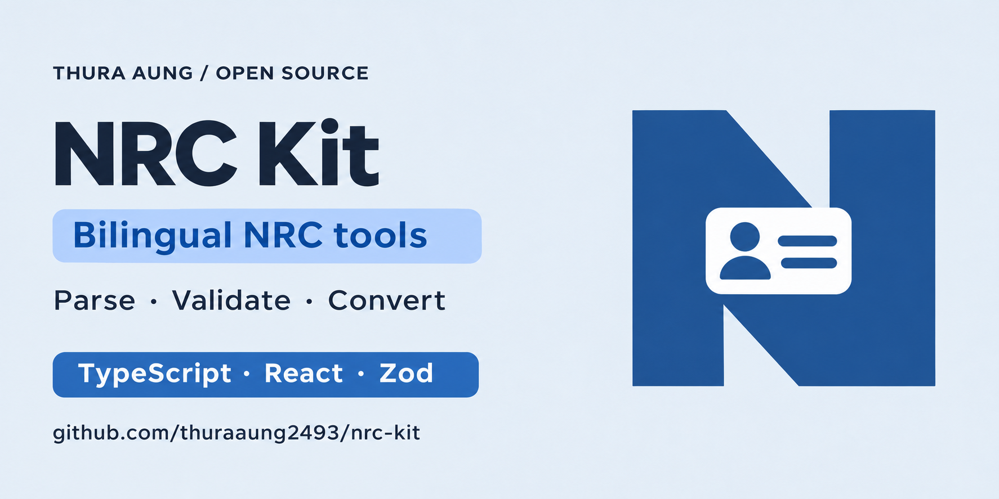

# NRC Kit



By [Thura Aung](https://github.com/thuraaung2493).

Parse, convert and validate Myanmar NRC numbers in English and Myanmar.
Works offline, with optional React and Zod support.

## Install

<!-- installation-command:start -->

```sh
npm install @thuraaung2493/nrc-kit
```

<!-- installation-command:end -->

See [installation and requirements](docs/installation.md).

## Basic usage

```ts
import { isValid, toEnglish } from '@thuraaung2493/nrc-kit';

isValid('12/LaMaNa(N)001234'); // true
toEnglish('၁၂/လမန(နိုင်)၀၀၁၂၃၄'); // '12/LaMaNa(N)001234'
```

Continue with the [quick start](docs/quick-start.md) and [API reference](docs/api-reference.md).

## React selector

See the [React selector guide](docs/guides/react-selector.md).

## Zod validation

See the [Zod validation guide](docs/guides/zod-validation.md).

## Add custom data

See the [custom data guide](docs/guides/custom-data.md) and [data notes](data/README.md).

## Contributing

See [contributing](CONTRIBUTING.md) for development and verification instructions.
